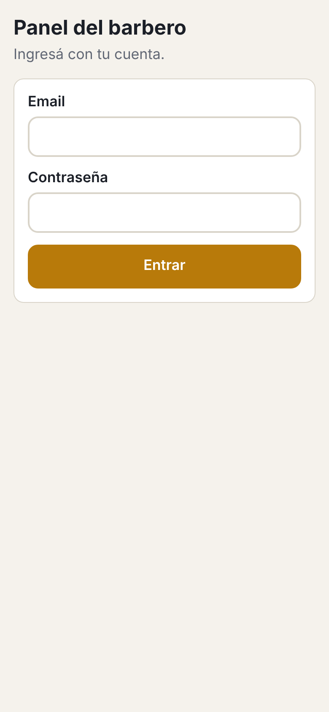
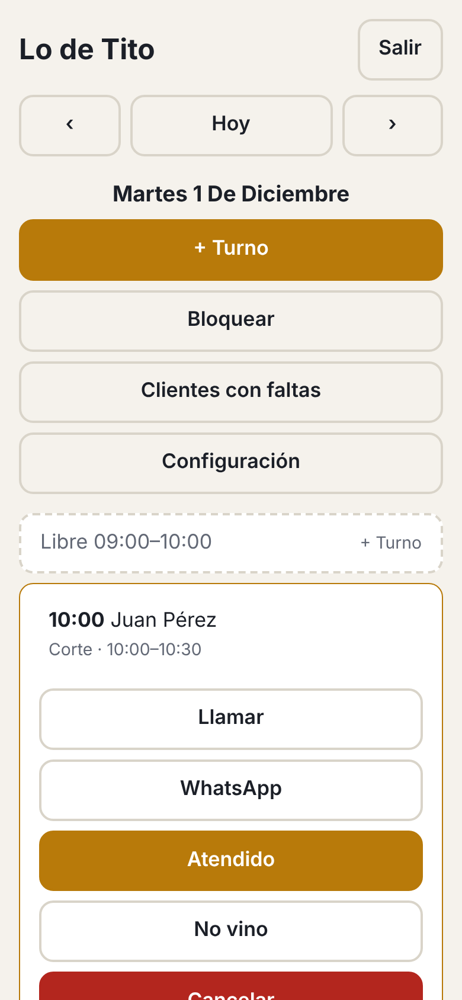
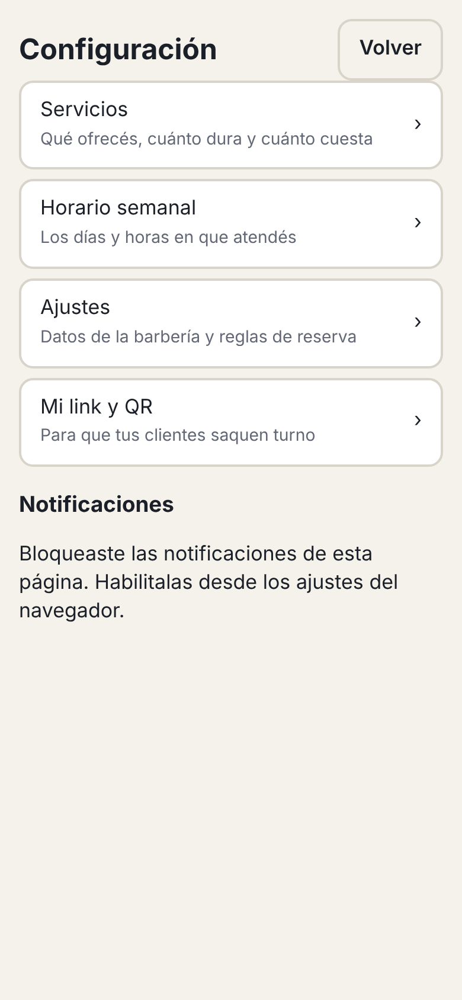
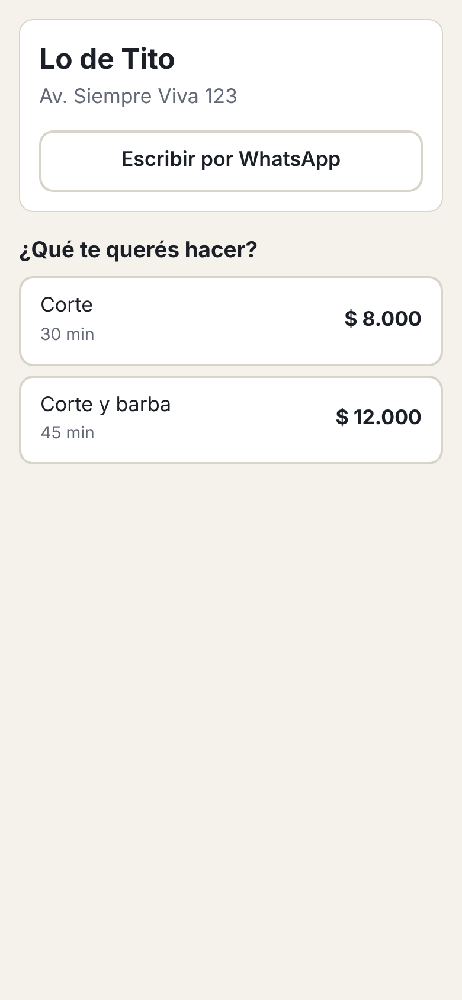
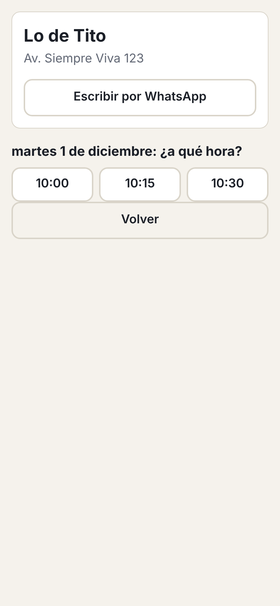
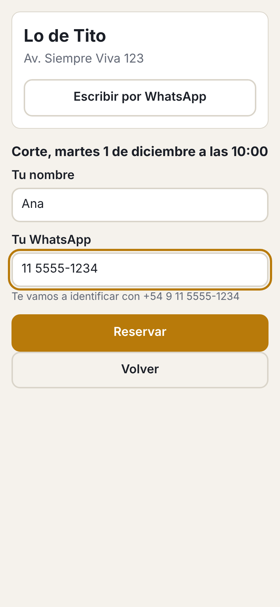
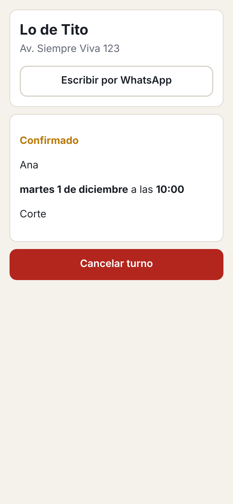

# Guía de uso

Tres partes, cada una para quien la necesita:

1. [Para vos (administrador)](#1-para-vos-administrador): dar de alta una barbería y qué hacer si algo se pausa.
2. [Para el barbero](#2-para-el-barbero): el panel del día a día. Está escrita para pasársela tal cual.
3. [Para el cliente](#3-para-el-cliente-lo-que-ve): cómo reserva y cancela.

Las dos direcciones públicas (una vez prendido GitHub Pages, ver [Publicar](#publicar-github-pages)):

- Cliente: `https://roca-byte.github.io/barber-turnos/index.html?b=<slug>`
- Panel del barbero: `https://roca-byte.github.io/barber-turnos/panel.html`

El `<slug>` es el nombre corto de la barbería en el link (por ejemplo `lo-de-tito`).

---

## 1. Para vos (administrador)

### Publicar (GitHub Pages)

La app es solo archivos: GitHub Pages los sirve tal cual, sin build. Esto lo hacés una vez y
cuando vos decidas, después de mergear la rama de trabajo a `main`:

1. Mergeá la rama a `main` (por Pull Request en GitHub, como siempre).
2. En el repositorio: **Settings → Pages**.
3. En **Build and deployment → Source** elegí **Deploy from a branch**.
4. En **Branch** elegí `main` y la carpeta `/ (root)`. Tocá **Save**.
5. Esperá uno o dos minutos y abrí `https://roca-byte.github.io/barber-turnos/panel.html`.
   Tiene que aparecer el ingreso del panel.

Cuando cambies archivos de la app, acordate de subir `VERSION` en `sw.js` (si no, los celulares
siguen con la versión vieja guardada).

### Dar de alta una barbería

Son dos pasos y los dos se hacen en el panel de Supabase.

**Paso 1: crear el usuario del barbero**

1. Entrá a tu proyecto en [supabase.com](https://supabase.com) → **Authentication → Users**.
2. Tocá **Add user** → **Create new user**.
3. Escribí el **email** y una **contraseña** (esas son las que le pasás al barbero para entrar
   al panel).
4. Dejá tildado **Auto Confirm User**. Sin eso el usuario queda pendiente de confirmar y no
   puede entrar.
5. **Create user**.

**Paso 2: correr el alta**

1. Abrí `docs/alta-barberia.sql` y copiá todo el contenido.
2. En Supabase: **SQL Editor → New query**, y pegalo.
3. Editá las cuatro variables del principio (y nada más):

   | Variable | Qué poner | Ejemplo |
   |---|---|---|
   | `v_slug` | Nombre corto del link: de 3 a 40 caracteres, minúsculas, números y guiones. No se repite entre barberías. | `lo-de-tito` |
   | `v_nombre` | Cómo se llama la barbería. | `Lo de Tito` |
   | `v_whatsapp` | Con código de país, sin `+` ni espacios. | `5491155550000` |
   | `v_email` | El mismo email del usuario del paso 1. | `tito@ejemplo.com` |

4. Tocá **Run**. Si sale bien, abajo aparece un mensaje con el link para el cliente:
   `https://roca-byte.github.io/barber-turnos/index.html?b=<slug>`.

El alta crea la barbería, un barbero con el mismo nombre, el vínculo con el usuario, un
servicio de ejemplo ("Corte", 30 min) y horarios de lunes a sábado (9 a 13 y 16 a 20). El
barbero después cambia todo eso solo desde el panel.

Si algo falla, el bloque se deshace completo y no queda nada a medias. Los dos errores típicos:

- *No existe ningún usuario con el email...*: el email no coincide con el del paso 1 (o no
  creaste el usuario todavía).
- Error de clave repetida: ese `v_slug` ya existe. Usá otro.

**Qué le pasás al barbero**: su email y contraseña, el link del panel
(`.../panel.html`) y la parte 2 de esta guía. El link para clientes lo saca él mismo desde
**Configuración → Mi link y QR**.

### Pausar o dar de baja una barbería

Con `activa = false` la barbería deja de aparecer para los clientes, pero se conserva todo
(turnos, clientes, horarios). En el SQL Editor:

```sql
update barberias set activa = false where slug = 'lo-de-tito';
```

Para reactivarla, lo mismo con `true`. (Está también al final de `docs/alta-barberia.sql`.)
Ojo: esto no desactiva el usuario; si además querés que no entre al panel, borralo o
cambiale la contraseña en Authentication → Users.

### Si Supabase pausa el proyecto

En el plan gratuito, Supabase **pausa el proyecto si pasa una semana sin actividad**. Cuando
pasa, los clientes ven un error al abrir el link y el panel no carga.

1. Entrá a [supabase.com](https://supabase.com) → tu proyecto.
2. Va a aparecer el aviso de proyecto pausado: tocá **Restore project** (en el Dashboard).
3. Esperá unos minutos a que termine. Los datos no se pierden.
4. Recargá el panel. No hay que tocar nada más.

Para que no se pause, alcanza con que haya movimiento (reservas, o entrar al panel) al menos
una vez por semana.

### Notificaciones: no hay nada que configurar

Los avisos de turno nuevo o cancelado se inicializan solos: el servidor genera sus propias
claves la primera vez que se usa, y no hay claves ni secretos para cargar en la app. Cada
barbero solo tiene que tocar **Activar notificaciones** en su celular (ver parte 2).

Si al activarlas aparece *"Las notificaciones todavía no están listas en el servidor. Probá
más tarde."*, es porque el servidor todavía no se usó ni una vez: hacé una reserva de prueba
desde el link del cliente (y cancelala) y probá otra vez.

El detalle técnico y cómo se corren las pruebas están en [`DESARROLLO.md`](../DESARROLLO.md).

---

## 2. Para el barbero

Todo se maneja desde el celular, en el **panel**. No hace falta bajar nada de la tienda de
aplicaciones.

### Entrar al panel

1. Abrí `https://roca-byte.github.io/barber-turnos/panel.html` en el celular.
2. Escribí tu **email** y tu **contraseña** y tocá **Entrar**.



Si te equivocás aparece *"Email o contraseña incorrectos"*. Para irte, tocá **Salir** arriba
a la derecha. Si pasa mucho tiempo, el panel te pide entrar de nuevo
(*"Tu sesión se cerró. Entrá de nuevo."*): no se pierde nada.

### Instalarlo en el celular

Instalarlo lo deja como una app más en la pantalla de inicio, y en iPhone es obligatorio para
recibir notificaciones.

- **Android (Chrome)**: abrí el panel, tocá los tres puntitos de arriba a la derecha y elegí
  **Instalar aplicación** (o **Agregar a la pantalla principal**, según el celular).
- **iPhone (Safari)**: abrí el panel **en Safari**, tocá el botón **Compartir** (el cuadrado
  con la flecha hacia arriba) y elegí **Agregar a inicio**.

Después abrí el panel desde el ícono nuevo.

### Activar las notificaciones

Para enterarte al instante cuando alguien reserva o cancela:

1. En el panel: **Configuración**. Abajo de todo está **Notificaciones**.
2. Tocá **Activar notificaciones** y, cuando el celular pregunte, **Permitir**.
3. Tiene que decir *"Las notificaciones están activadas en este dispositivo."*

Cosas que pueden aparecer en vez del botón:

- *"En iPhone primero agregá esta página a la pantalla de inicio: Compartir → Agregar a
  inicio."*: instalala como se explicó arriba y abrila desde el ícono.
- *"Bloqueaste las notificaciones de esta página. Habilitalas desde los ajustes del
  navegador."*: entrá a los ajustes del navegador (o del celular) y permitilas para esta
  página.
- *"Este navegador no permite notificaciones."*: probá con Chrome (Android) o Safari
  (iPhone).

Las notificaciones son por dispositivo: si usás dos celulares, activalas en cada uno. Para
apagarlas, el mismo botón dice **Desactivar notificaciones**. Si hacés vos mismo un turno o una
cancelación desde el panel, no te avisa.

### La agenda

Al entrar ves el día de hoy: tus turnos, los bloqueos y los huecos libres, ordenados por hora.



- **‹ Hoy ›** cambia de día.
- Tocá un turno para abrirlo: aparecen **Llamar**, **WhatsApp**, **Atendido**, **No vino**
  y **Cancelar**.
- Un turno marcado como atendido, no vino o cancelado tiene el botón **Deshacer**.
- Los turnos que cargaste vos dicen "cargado por vos".

### Cargar tus servicios

**Configuración → Servicios**

- **+ Servicio**: nombre, duración en minutos (de 5 en 5, entre 5 y 240) y precio. El precio
  es solo informativo: la app no cobra.
- **Editar** cambia un servicio. Para sacarlo de la lista de reservas sin perder su historial,
  destildá **Se puede reservar**: queda como *Oculto*.
- **↑ / ↓** cambian el orden. Es el orden en que lo ven tus clientes.

### Cargar tus horarios

**Configuración → Horario semanal**



1. Cada día tiene su tarjeta. Tocá **+ Agregar franja** y poné desde y hasta.
2. Podés poner más de una franja por día (por ejemplo 9 a 13 y 16 a 20).
3. La **✕** saca una franja. Un día sin franjas es un día que no atendés.
4. Tocá **Guardar horario**.

Los cambios valen para turnos nuevos: los que ya estaban reservados no se tocan.

### Cargar un turno a mano

Para el cliente que te escribe por WhatsApp o que llega sin turno:

1. En la agenda tocá **+ Turno**. O tocá un horario **Libre**, que ya trae la hora puesta.
2. Elegí el **Servicio**, la **Hora** y escribí el **Nombre**. El **WhatsApp** es opcional (sin
   número no se le pueden mandar avisos).
3. **Guardar turno**.

Si el horario ya está ocupado, te avisa y no lo carga.

### Bloquear horarios

Para un trámite, vacaciones o un día que no atendés:

1. En la agenda tocá **Bloquear**.
2. Elegí **Desde** y **Hasta** (fecha y hora) y, si querés, un **Motivo**. **Bloquear**.
3. Los clientes ya no pueden reservar en ese rango.

Si ya tenías turnos adentro, aparece **Bloqueo guardado** con la lista de esos turnos: tocá
**Avisar por WhatsApp** (te arma el mensaje) y, si hace falta, **Cancelar este turno**. Los
turnos que ya había **no se cancelan solos**.

Para destrabar horas, abrí ese día en la agenda y tocá **Quitar bloqueo**.

### Faltas

Si un cliente no viene, abrí su turno y tocá **No vino**. Le suma una falta, y aparece un
**⚠ 1 falta** al lado de su nombre cada vez que tenga un turno.

Cuando llega a la cantidad de faltas que configuraste (por defecto **2**), ya no puede
reservar online: le aparece un mensaje para que te escriba por WhatsApp.

Para ver quiénes tienen faltas: **Clientes con faltas**. Ahí figuran los **Bloqueados**, y
con **Desbloquear** les devolvés la posibilidad de reservar.

### Ajustes de la barbería

**Configuración → Ajustes**. Datos de la barbería (nombre, dirección, WhatsApp) y las reglas.
Los valores por defecto, con lo que significan:

| Ajuste | Por defecto | Para qué sirve |
|---|---|---|
| Horas para cancelar | 2 | Hasta cuántas horas antes puede cancelar el cliente solo. |
| Faltas para bloquear | 2 | Faltas después de las cuales deja de poder reservar online. |
| Días hacia adelante | 21 | Con cuántos días de anticipación se puede reservar. |
| Anticipación mínima (minutos) | 30 | Cuánto antes del turno se cierra la reserva. |
| Paso de la grilla (minutos) | 15 | Cada cuántos minutos se ofrece un horario. |
| Turnos pendientes por cliente | 2 | Cuántos turnos futuros puede tener la misma persona. |

Tocá **Guardar ajustes** al terminar. No hace falta tocar nada de esto para empezar.

### Tu link y el QR

**Configuración → Mi link y QR**

- **Copiar link**: es el link para que tus clientes saquen turno. Pegalo en un mensaje.
- **Imprimir**: imprime una hoja con tu nombre, el QR y "Sacá tu turno acá". Pegala en el
  local o en el espejo.

### Ponerlo en tu perfil de WhatsApp e Instagram

1. Copiá el link con **Copiar link**.
2. **WhatsApp Business**: en el perfil de la empresa, agregá el link como sitio web (o ponelo
   en la descripción). Cambia un poco según la versión; buscá la parte del perfil donde se
   carga el sitio.
3. **Instagram**: **Editar perfil → Enlaces → Agregar enlace externo** y pegalo. Sirve
   también para la biografía.

También podés mandarlo como respuesta rápida cada vez que alguien te pida turno.

---

## 3. Para el cliente (lo que ve)

No hace falta crear cuenta ni bajar nada: alcanza con el link o el QR de la barbería.

### Reservar

1. Abrí el link. Arriba está el nombre de la barbería, la dirección y **Escribir por
   WhatsApp**. Elegí el servicio en **¿Qué te querés hacer?**

   

2. Elegí el día. Solo aparecen días con lugar.
3. Elegí la hora.

   

4. Escribí **Tu nombre** y **Tu WhatsApp** (con o sin código de área). Mientras escribís, la
   pantalla te muestra el número con el que te va a identificar. Tocá **Reservar**.

   

5. Aparece *"¡Listo, <nombre>! Tu turno quedó reservado."* con el día, la hora y **un link**.
   **Guardá ese link**: es la única forma de ver o cancelar el turno. Hay dos botones:
   **Agregar a mi calendario** y **Mandarme el link por WhatsApp**.

Todas las horas se muestran en la zona de la barbería, esté donde esté el celular.

Si justo otra persona se lleva el horario, avisa *"Ese horario se acaba de ocupar. Elegí
otro."* y muestra los horarios que quedan.

### Ver o cancelar el turno

Con el link que te dio al reservar se abre el turno: estado (**Confirmado**), nombre, día,
hora y servicio.



- **Cancelar turno** → *"¿Seguro que querés cancelar el turno?"* → **Sí, cancelar** (o **No,
  lo dejo**). Se puede hasta unas horas antes (2 por defecto, lo define cada barbería).
- Pasado ese plazo ya no aparece el botón: dice *"Ya no podés cancelar online. Si necesitás
  cambiarlo, escribile a la barbería."* y ofrece **Escribir por WhatsApp**.
- Si el estado dice **No viniste**, es que el barbero lo marcó como falta.

Si perdés el link, escribile a la barbería por WhatsApp.

### Si no te deja reservar

- *"No podés reservar online. Escribile a la barbería por WhatsApp."*: acumulaste faltas.
- *"Ya tenés los turnos futuros máximos. Cancelá uno o esperá a que pase."*: ya tenés la
  cantidad máxima de turnos pendientes.
- *"Hiciste muchas reservas seguidas. Probá en un rato."*: límite de seguridad por hora.
